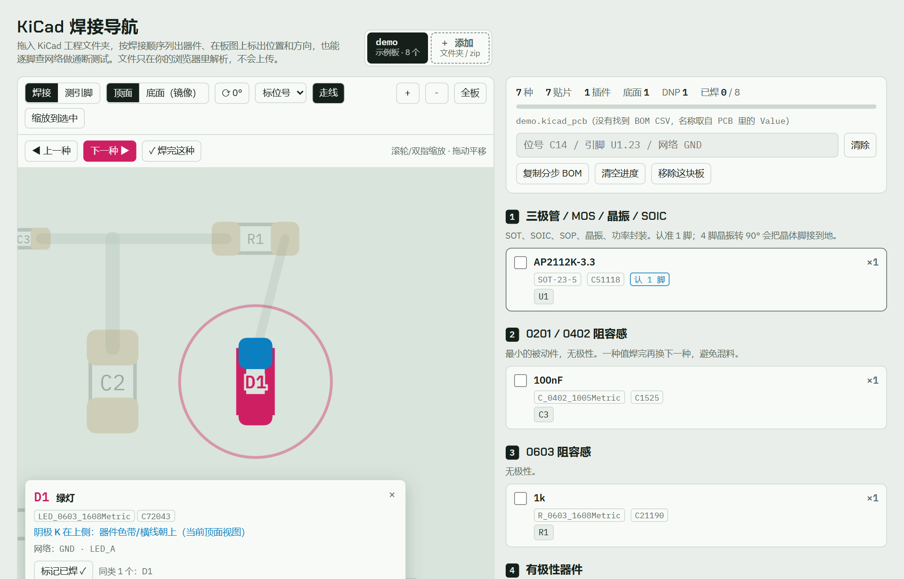
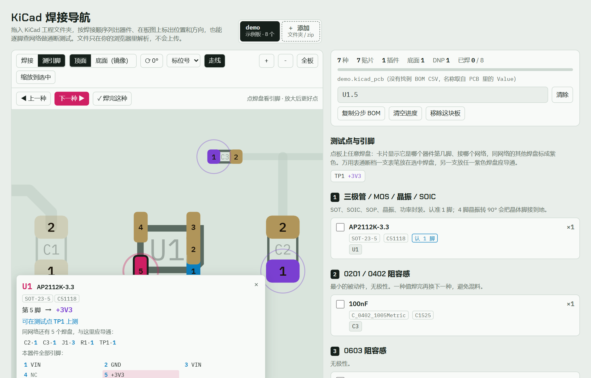

# KiCad 焊接导航

手工焊 KiCad 板子的辅助工具，一个网页文件，打开就能用。

把工程文件夹拖进去，它会：

- **按焊接顺序分步列出器件**：细间距芯片 → 三极管/晶振 → 0402 → 0603 → 有极性件 → 大件 → 开关 → 底面 → 插件。同值同封装的器件归成一组。
- **在板图上标出位置**：点一组，这种器件在板上全部高亮并自动缩放。小到 0402 也能一眼找到。
- **标出方向**：1 脚、二极管/LED 阴极、电解/钽电容正极用蓝色焊盘标出，并直接说"阴极 K 在左侧"。底面视图已镜像，翻面、旋转后方向提示会跟着变。
- **测引脚**：点任意焊盘，显示是哪个器件第几脚、接什么网络，同网络的其他焊盘全部标出来，配合万用表通断档查虚焊、连锡。悬空脚和 NC 也会单独提示。
- **记进度**：每个器件可以勾"已焊"，下次打开还在。

## 使用

**在线**：<https://3977871701-spec.github.io/kicad-solder-nav/>

**离线**：下载 [`index.html`](index.html)，双击用浏览器（Chrome / Edge / Firefox）打开即可。离线时 zip 解压不可用，直接拖文件夹就行。

读入方式（任选）：

- 把工程**文件夹**拖进页面，或点"选择文件夹"
- 拖 **zip** 压缩包（例如微信/邮件收到的工程包）
- 只选 `.kicad_pcb`，可同时选 BOM 的 `.csv`

一个文件夹里有多块板会全部读入，每块板一个标签页。

## 能读什么

| 内容 | 来源 |
| --- | --- |
| 器件位置、焊盘形状（矩形/圆角/圆/椭圆/梯形/倒角/自定义）、钻孔 | `.kicad_pcb`（KiCad 6 ~ 10） |
| 网络、走线、过孔、板框、丝印、Fab 外形 | `.kicad_pcb` |
| Value、LCSC / MPN 字段、DNP、不进 BOM、原理图页 | 器件属性 |
| 名称、料号（可选） | 同目录下文件名带 `bom` 的 CSV，含 `Designator` 或 `Reference` 列，Comment / LCSC 列自动识别（嘉立创 BOM、KiCad 导出 BOM 都可以） |

BOM 里写在括号里的备注，如"（缺货，下单前确认）"，会作为警告显示在对应器件上。

## 判断规则

- **焊接顺序**按封装名和位号前缀判断：`QFN/DFN/LGA/BGA/QFP/TSSOP/FPC/Type-C` 算细间距，`SOT/SOIC/晶振` 算第二步，阻容按 0402 / 0603 / 0805+ 分，`D/LED` 和电解/钽电容算有极性，底面贴片和插件单独放最后。
- **极性**按 KiCad / 立创封装惯例：二极管、LED 的 1 号焊盘是阴极，电解/钽电容、电池、蜂鸣器的 1 号焊盘是正极。双向 TVS（`-BI` 封装或 `xxCA` 型号）判为无极性。少数厂家封装例外，焊前请对一下丝印。
- 测试点、安装孔、Mark 点、Logo、标了"不进 BOM"的器件不进焊接清单；测试点在"测引脚"模式里可以直接点。

## 快捷键

| 键 | 作用 |
| --- | --- |
| `N` / `]` | 下一种没焊完的 |
| `[` | 上一种 |
| `空格` | 这种全部标记已焊，跳到下一种 |
| `T` | 切换焊接 / 测引脚 |
| `F` | 翻面 |
| `R` | 旋转 90° |
| `0` | 显示全板 |
| `Esc` | 清除选中 |

## 隐私

所有文件只在浏览器本地解析。读入的板子和勾选进度保存在当前浏览器的 IndexedDB / localStorage 里，不上传任何服务器。页面只从公共 CDN 加载字体和 zip 解压库（JSZip）。

## 不支持

- KiCad 5 及更早的格式（`(module …)`）：用新版 KiCad 打开后另存即可
- Altium、嘉立创 EDA、Eagle 等其他 EDA 的文件
- 原理图（`.kicad_sch`）：引脚只显示焊盘号和网络名，不显示芯片引脚功能名

## 开发

单文件，无构建步骤。解析器在 `index.html` 里 `/*PARSER-START*/ … /*PARSER-END*/` 之间，不依赖 DOM，可以直接在 Node 里跑。它的输出与 KiCad 10 自带的 `pcbnew` Python API 逐焊盘对比过：3 块共 834 个焊盘，中心误差 ≤ 0.01 mm，网络 100% 一致。

## 许可

MIT
