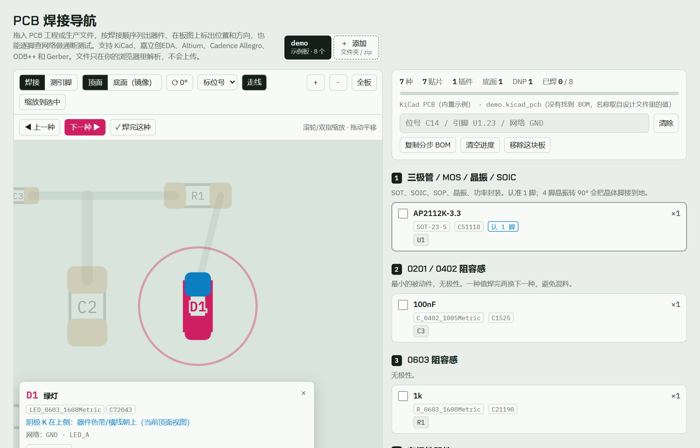
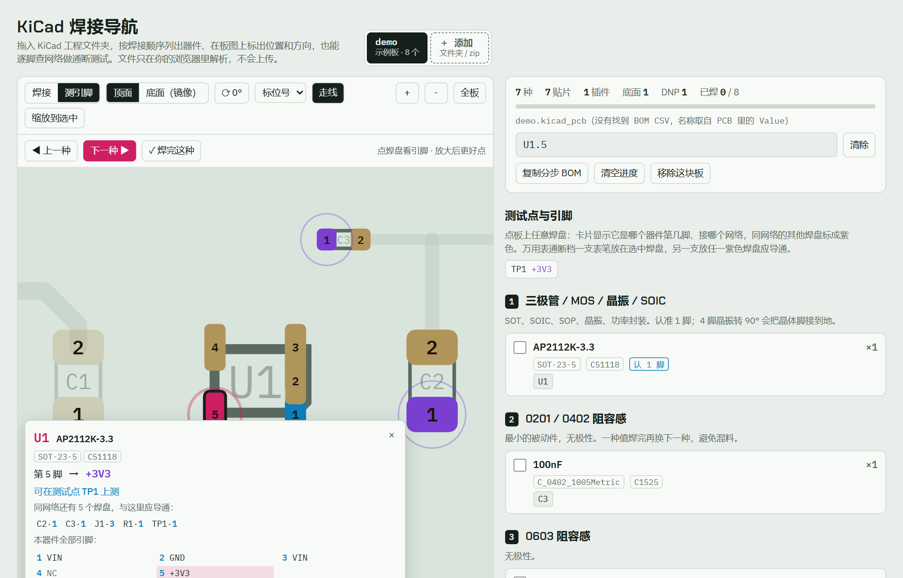

# PCB 焊接导航

手工焊板子的辅助工具，一个网页文件，打开就能用。支持 **KiCad、嘉立创EDA、Altium Designer、Cadence Allegro / OrCAD、ODB++、Gerber**。

把工程文件夹（或 zip）拖进去，它会：

- **按焊接顺序分步列出器件**：细间距芯片 → 三极管/晶振 → 0402 → 0603 → 有极性件 → 大件 → 开关 → 底面 → 插件。同值同封装的器件归成一组。
- **在板图上标出位置**：点一组，这种器件在板上全部高亮并自动缩放。小到 0402 也能一眼找到。
- **标出方向**：1 脚、二极管/LED 阴极、电解/钽电容正极用蓝色焊盘标出，并直接说“阴极 K 在左侧”。底面视图已镜像，翻面、旋转后方向提示跟着变。
- **测引脚**：点任意焊盘，显示是哪个器件第几脚、接什么网络，同网络的其他焊盘全部标出来，配合万用表通断档查虚焊、连锡。
- **查连锡**：测引脚时列出同一器件上紧挨着的焊盘：同网络的连上也没事，不同网络的标橙色并在板上画虚线圈，连锡就是短路。
- **上电前检查**：自动找出所有电源网络（VCC、3V3、VBUS…），逐个量对地电阻并打勾，排除短路再通电。
- **双面对照**：选中的网络同时连到顶面和底面时，板图自动左右分屏（左顶面、右底面镜像），两边各自框住所有同网络引脚；也可以按 `D` 手动开关。
- **记进度**：每个器件可以勾“已焊”，下次打开还在；误操作可以撤销（`U` / `Ctrl+Z`）；重新导入改过的板子，已焊标记保留。列表可以隐藏已焊完的种类。




## 使用

**在线**：<https://3977871701-spec.github.io/pcb-solder-nav/>

**离线**：下载 [`index.html`](index.html)，双击用浏览器（Chrome / Edge / Firefox）打开。不依赖任何外部库，离线也能解压 zip。

读入方式：把文件夹、zip 或单个文件拖进页面，或点“＋ 添加”（文件 / zip）、“＋ 文件夹”。一个文件夹里有几块板就读出几块，同目录的 BOM、坐标文件、网表会自动配上。

**压缩包**：zip、rar（RAR5，WinRAR 5 以后的默认格式）、tar / tgz 都能直接读，压缩包里套压缩包也行。解压代码是页面自带的，不依赖浏览器。老的 RAR4 格式、带密码或分卷的压缩包读不了，页面会提示。

**iPad / iPhone**：Safari 不能选文件夹。点“＋ 添加”直接选 zip 或 rar；要传整个文件夹，先在“文件”App 里长按文件夹 → “压缩”。

## AD 原理图库

右上角“原理图库”支持导入 Altium 的二进制或 ASCII `.SchDoc`，以及 OrCAD Capture 的 `.DSN`（每页一张图），也可直接拖入 zip / rar 工程包。读取嵌入的器件符号、位号、参数、引脚、导线、网络标号和注释；不需要另找 `.SchLib`。支持“内容”聚焦和“全页”缩放、器件与网络搜索、点击详情、文字/网格开关。

**AD 格式输出**：“导出 SchLib”生成原生 OLE2 `.SchLib`，包含独立符号数据流、二进制引脚、中文参数和多单元器件；“原始 SchDoc”下载字节不变的原始 AD 图纸，不是改扩展名或 SVG。原始 SchDoc 仅保存在本机、不会上传，其他设备需重新导入原件才能下载；同步后的解析数据仍可生成 SchLib。

原理图独立保存和删除，不与 PCB 焊接清单混在一起。登录云同步后也能在其他设备打开。网络连通性按导线、节点和同名标号推导，仅供参考，不能替代 Altium 的 ERC / 编译结果；原文件未指定封装的器件保持未指定，不会自动猜填。常用矢量图元可直接显示，嵌入图片暂不显示；此功能只读，不回写原始 `.SchDoc`。SchLib 保留封装名称；如果电脑里没有对应的 `.PcbLib`，仍需在 AD 中匹配封装库。

## 板子管理、备份与跨设备同步

板子、原理图和焊接进度始终先保存到本机 IndexedDB / localStorage，断网也能导入、删除和勾选进度。点右上角“板子管理”可以切换、删除当前板或清空全部板子；“原理图库”可以导入、查看和单独删除 AD `.SchDoc` 图纸；删除需要再次确认。

GitHub Pages 是静态托管，跨设备同步需要部署者配置一次 Supabase（免费额度即可）：

1. 在 [Supabase](https://supabase.com/) 创建项目，打开 **SQL Editor**，执行本项目的 [`supabase.sql`](supabase.sql)。脚本会创建数据表和行级安全策略，每个登录账号只能读写自己的数据。
2. 在 **Authentication → Sign In / Providers** 中启用 Email。网站右上角“本地保存 / 登录云同步”使用邮箱验证码登录，不需要密码。
3. 打开网页的“存储与云同步 → 云服务设置”，填写 **Project URL** 和 **anon public key**。不要填写 `service_role` key。
4. 若要让所有访客免填配置，部署者在 `src/shell.html` 的模块脚本前加入以下配置（anon key 本来就是可公开的客户端 key，数据隔离由行级安全策略保证），再运行 `node build.js`：

```html
<script>globalThis.PSN_CLOUD_CONFIG = { url: "https://你的项目.supabase.co", anonKey: "你的 anon public key" };</script>
```

登录后会自动同步板子、原理图、焊接进度和删除记录；断网期间的修改会保留在本机，恢复网络后补传。其他设备使用相同云服务和账号登录即可看到相同内容。同步采用每份文档“最后修改优先”的冲突规则，不建议多台设备同时修改同一块板。原理图复用 `psn_boards` 表的 `payload.schematic` 字段，已有 Supabase 表不需要修改。

## 支持的文件

| EDA | 直接读 | 也可以用 |
| --- | --- | --- |
| KiCad 6 ~ 10 | `.kicad_pcb` | IPC-2581、ODB++、Gerber 套件 |
| 嘉立创EDA 专业版 | 工程 `.epro` / `.epro2`，备份 `.epru`（含封装）；一个工程多块板会分开显示 | 嘉立创 Gerber 包（自带 `FlyingProbeTesting.json` 网表） |
| 嘉立创EDA 标准版 | PCB 源文件 `.json` | Gerber 套件 |
| Altium Designer | `.PcbDoc`（二进制和 ASCII）；`.SchDoc` 在“原理图库”查看 | IPC-2581、ODB++、Gerber + Pick Place + IPC-356 |
| Cadence Allegro / OrCAD | `.brd`（Allegro 16.0 以后的格式）；OrCAD 原理图 `.DSN` 在“原理图库”查看 | IPC-2581（File → Export → IPC 2581）；Gerber/`.art` + 坐标 + IPC-356（File → Export → IPC 356） |
| PADS、Xpedition 等 | IPC-2581、ODB++ | Gerber 套件 |

Allegro `.brd` 直接读出器件、焊盘（形状、尺寸、钻孔）、引脚号、网络、器件值、板框、走线、过孔、顶底面铺铜、丝印外框和丝印文字。实测过 16.6 / 17.2 / 17.4 / 18.1 / 19.0 格式的板子，其他 16.x / 17.x 格式按同样的结构读，页面会提醒核对；Allegro 16.0 以前的老文件或读不出来的文件，页面会写明文件版本，请改用 IPC-2581。八边形、十字、菱形、六边形、三角形、环形等少见焊盘形状没有样板验证过，遇到时页面会提醒核对。OrCAD `.DSN` 读出器件符号、位号、器件值、引脚、导线、网络标号、电源符号和跨页端口，实测过 3.2 版设计库（Capture 16.6 ~ 17.4）；多单元器件的单元顺序按放置顺序推断，页面会提示。Eagle 的 `.brd` 请先用 KiCad 打开另存为 `.kicad_pcb`。嘉立创本地工程库 `.eprj2` 也请先导出成 `.epro2`。

**Gerber 套件** = Gerber + 钻孔 + 坐标文件（Pick and Place / CPL）。再加一个 IPC-356 网表或嘉立创飞针文件，就有引脚号和网络；没有网表时，焊盘按“中心对称 + 封装尺寸”归到器件，测引脚不可用，页面会提示。坐标文件和 Gerber 的原点、单位（mm / mil / inch）、Y 方向不一致时会自动对齐。

**BOM**：CSV 或 Excel（.xlsx），带 `Designator` / `Reference` / 位号 列即可，自动识别 Comment、LCSC、MPN、封装、DNP 列，GBK / UTF-16 编码也能读。BOM 里写在括号里的备注（如“缺货，下单前确认”）会显示为警告。

## 准确性

每种格式都拿同一块板的另一份权威数据逐焊盘比对过：

| 格式 | 参照 | 结果 |
| --- | --- | --- |
| KiCad `.kicad_pcb` | KiCad 自带 pcbnew API | 3 块板 834 个焊盘，位置误差 ≤ 0.01 mm，网络 100% 一致 |
| IPC-2581（KiCad 导出 / Allegro 导出） | pcbnew；同板的嘉立创工程 | ≤ 0.001 mm，网络一致 |
| ODB++（KiCad 导出） | pcbnew | ≤ 0.012 mm（导出文件只保留 2 位小数） |
| 嘉立创EDA 专业版 | Allegro 原设计；嘉立创自己的飞针文件 | 0 偏差；底面 0/90/180/270° 全部正确 |
| Altium `.PcbDoc` | KiCad 的 Altium 导入器（5 块板） | ≤ 0.0014 mm，网络、器件值一致 |
| Allegro `.brd` | 文件里 Allegro 自己存的每个焊盘的板上外框；Allegro 导出的 `.alg` | 8 块板（16.6 / 17.2 / 17.4 / 18.1 / 19.0 格式）焊盘 ≤ 0.001 mm，含底面和 45° 旋转；网络、铺铜面积、丝印文字与 `.alg` 一致 |
| OrCAD `.DSN` | 同一设计的 Allegro `.brd` | 86 个位号、器件值全部一致；引脚的网络名 286/287 一致 |
| 嘉立创EDA 标准版 | 走线端点自洽检查 | 184 个走线端点全部落在同网络焊盘上 |
| Gerber + 坐标 + IPC-356 | Allegro IPC-2581 | 350 个焊盘 0 偏差，引脚号和网络一致 |

## 判断规则

- **焊接顺序**按封装名和位号前缀判断：`QFN/DFN/LGA/BGA/QFP/TSSOP/FPC/Type-C` 算细间距，`SOT/SOIC/晶振` 算第二步，阻容按 0402 / 0603 / 0805+ 分，`D/LED` 和电解/钽电容算有极性，底面贴片和插件放最后。
- **极性**按常见封装库惯例（KiCad、立创、Altium）：二极管、LED 的 1 号焊盘是阴极，电解/钽电容、电池、蜂鸣器的 1 号焊盘是正极。没有 1 号焊盘时，二极管认 `K`、电容认 `+`、BGA 认 `A1`。双向 TVS（`-BI` 封装或 `xxCA` 型号）判为无极性。少数厂家封装例外，焊前对一下丝印。
- **电源网络**按名字判断：`3V3`、`+5V`、`1V8`、`VCC*`、`VDD*`、`VBUS`、`VBAT`、`VIN`、`VSYS` 等；`GND*`、`VSS*` 算地。
- 测试点、安装孔、Mark 点、Logo、标了“不进 BOM”的器件不进焊接清单；测试点在“测引脚”模式里可以直接点。
- 底面器件按同样的顺序再分一遍（底面 · 细间距芯片 → …），插件放在最后。
- 设计里有重复位号时，重复的依次加 (2)、(3) 区分，并在页面上提示。
- 重新导入同一个文件夹，会替换这个文件夹之前读出来的板子。

## 快捷键

| 键 | 作用 |
| --- | --- |
| `N` / `]` | 下一种没焊完的 |
| `[` | 上一种 |
| `空格` | 这种全部标记已焊，跳到下一种 |
| `U` / `Ctrl+Z` | 撤销上一次进度修改（含清空进度） |
| `D` | 测引脚时开关双面对照 |
| `T` | 切换焊接 / 测引脚 |
| `F` | 翻面 |
| `R` | 旋转 90° |
| `0` | 显示全板 |
| `Esc` | 清除选中 |

## 隐私

所有原始文件只在浏览器本地解析。默认情况下，读入的板子、原理图和勾选进度只保存在当前浏览器的 IndexedDB / localStorage 里；只有用户主动配置并登录云同步后，解析后的板图、原理图、器件、进度和删除记录才会通过 HTTPS 保存到其 Supabase 项目，原始 PCB / SchDoc / Gerber / 压缩包不会上传。页面只从 Google Fonts 加载字体，而且不等它：连不上 Google 时直接用系统字体，页面照常打开。

## 开发

源码在 `src/`，`node build.js` 把它们打包成单文件 `index.html`（没有依赖）。

```
src/core/      dom 公共界面工具、geom 几何、files 解压、rar RAR5 解压、tables 表格/网表、project 文件归组
src/import/    kicad、ipc2581、easyeda、altium、altium_sch、allegro、orcad_dsn、odb、gerber、fab
src/schematic.js  AD 原理图库、图纸交互与 AD 文件下载
src/export/    altium_schlib 原生 OLE2 / SchLib 和二进制引脚写入
src/enrich.js  焊接分步、极性、分组
src/cloud.js   Supabase 登录与 REST 同步（无外部依赖）
src/app.js     界面、本地存储与同步合并
```

解析模块不依赖 DOM，可以直接在 Node（≥ 18）里跑；`test/` 里是对照测试脚本，其中 `run_all.js` 需要本地样本数据（不在仓库里）。`node test/cloud.js` 可直接验证云端 API 协议；`test/browser_sync.js` 使用 Chrome DevTools Protocol 验证真实导入和模拟双设备同步。

Allegro 测试需要本地样本：`ALLEGRO_BRD=/样本.brd ALLEGRO_ZIP=/样本.zip ALLEGRO_SVG=/输出.svg node test/allegro.js`，`ALLEGRO_EXTRA=/a.brd:/b.brd` 可再加几块板做对照。OrCAD 原理图测试：`ORCAD_DSN=/样本.DSN ORCAD_ZIP=/样本.zip ORCAD_SVG=/输出目录 node test/orcad_dsn.js`。

AD 原理图测试需要本地样本：`SCH_SAMPLES=/样本目录 node test/altium_sch.js` 验证三页解析；`SCH_RAR=/样本.rar node test/schlib_export.js` 验证原生 SchLib、二进制引脚和中文参数；在 9223 端口打开测试 Chrome 后，运行 `SCH_RAR=/样本.rar node test/browser_schematic.js` 验证真实 RAR 导入、看图、SchLib 导出、原始 SchDoc 下载、刷新、同步和删除。

## 许可

MIT
